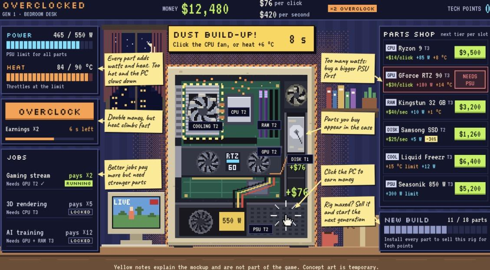
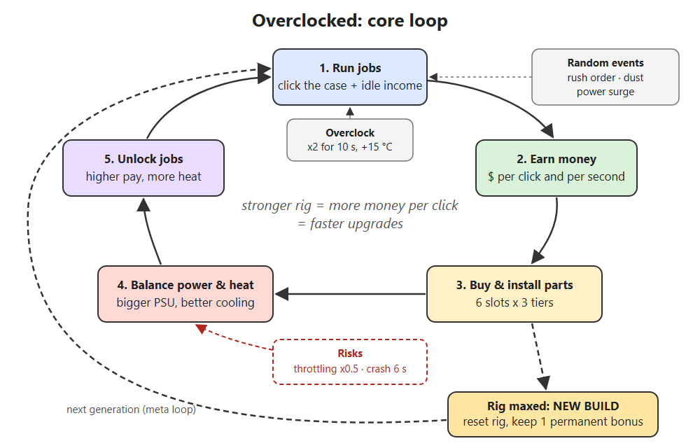

# Overclocked

*Cookie Clicker* meets *PC Building Simulator* — click to earn, upgrade your rig part by part, and watch a dusty office PC turn into a glowing beast that can run anything.

**Play the prototype:** https://maiko-nigul.github.io/overclocked/
(built automatically from `main` — see [Build and deploy](#build-and-deploy))



| Genre | Platform | Engine |
|---|---|---|
| Incremental / clicker with light build management | Browser (desktop, mouse) | Godot 4.3 (GDScript), HTML5 export |

Full design: **[Game Design Document](docs/game-design-document.md)** (rules, resources, core loop, progression) · [one-pager](docs/one-pager.docx) — TLÜ game design course, Monday cohort.

## Core loop




1. Click the PC → it runs a job and earns money.
2. Buy and install parts → higher earnings per click and per second (idle income).
3. Parts raise power draw and heat → upgrade the PSU and cooling or the PC throttles.
4. Unlock better jobs (gaming streams, 3D rendering, AI training) that pay more but need stronger hardware.
5. Rig maxed out → **New Build** (prestige): sell the PC, start a new hardware generation with permanent bonuses.

## Lo-fi prototype scope (Assignment 10)

Placeholder visuals only (grey boxes, plain buttons, text bars). Goal: test the core loop and the power/heat balance.

- [x] Click the PC box → money; show money, earnings per click and per second
- [x] Shop with 6 slots (CPU, GPU, RAM, storage, cooling, PSU), 2 tiers each
- [x] Idle income every second
- [x] Power limit: a part that would exceed PSU watts cannot be bought
- [x] Heat and throttling: above the cooling limit, earnings are halved
- [x] Overclock button: ×2 earnings for 10 s, adds heat

## Prototype v2 (Game Design Document assignment)

Still placeholder visuals; the rest of the MVP gameplay is now in:

- [x] Tier 3 parts (6 slots × 3 tiers = 18 parts), 1600 W PSU, Cryo cooler
- [x] Overheat crash: heat ≥ limit + 15 °C → PC off for 6 s
- [x] Overclock unlocks with the first cooler
- [x] 4 jobs (office, streaming, 3D rendering, AI training): unlocked by parts, more pay but more heat
- [x] Random events: rush order (×3), dust build-up (+12 °C until cleaned), power surge (crash above 85 % PSU load)
- [x] Win screen with run time and best time → New Build with 3 stackable permanent bonuses
- [x] Auto save and load in the browser + reset button

Not yet: final art, visible part sprites, sound.

## MVP (final prototype)

One playable screen, full upgrade path and one New Build cycle (about 15–20 min of play): 5 part slots + PSU with 3 tiers each (18 items), visible part changes in the case, power/heat/throttling, 3 jobs, New Build with 3 permanent bonuses, save/load in the browser.

## Team

| Member | Role | Responsibilities |
|---|---|---|
| Glen Gregor Paas | Lead programmer + producer | Core loop, shop and upgrade logic, power/heat system, events, save/load; schedule and task board |
| Maiko Nigul | Game designer + artist | Balancing (prices, earnings, heat values), PC case and part art, UI layout, sound effects |

## Work plan

1. **Weeks 1–2:** finalize design, set up repo; playable click → money → buy part loop
2. **Weeks 3–4:** all parts and tiers, power/heat mechanic, first art pass
3. **Weeks 5–6:** jobs, New Build prestige, visual part swapping
4. **Final weeks:** balancing, playtesting, bug fixing, presentation

Tasks live in GitHub Projects; communication on Discord.

## Project structure

```
project.godot        Godot 4 project (GL Compatibility renderer, 1920×1080)
export_presets.cfg   "Web" export preset (no threads, works on GitHub Pages)
scenes/              .tscn scenes (main.tscn is the entry scene)
scripts/             GDScript files
assets/art/          Piskel exports (PNG)
assets/audio/        sfxr sound effects
docs/                game design document, core loop diagram, one-pager, mockup
```

## Getting started

1. Install [Godot 4.3](https://godotengine.org/download/archive/4.3-stable/) (standard build, not .NET).
2. `git clone https://github.com/maiko-nigul/overclocked.git`
3. Godot Project Manager → **Import** → select `project.godot` → run with F5.

## Workflow

- One branch per task: `feature/shop`, `feature/heat`, `art/case-tier1` …
- Open a pull request into `main`; the other person reviews and merges.
- Each person commits from their own GitHub account, so contributions are visible in the history.

## Build and deploy

Every push to `main` runs `.github/workflows/deploy-web.yml`: it exports the project with the **Web** preset and publishes it to GitHub Pages at https://maiko-nigul.github.io/overclocked/. One-time setup: repo **Settings → Pages → Source: GitHub Actions**.
