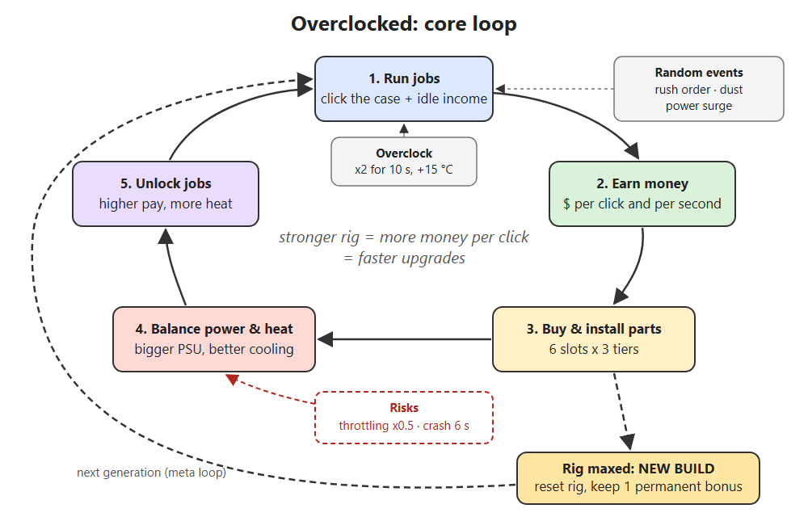
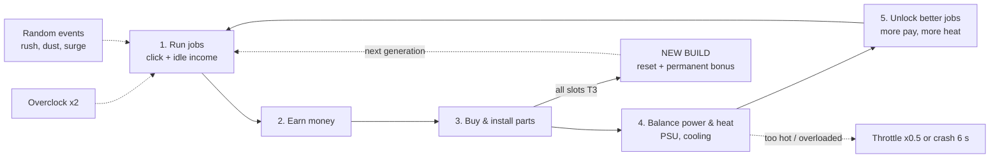

# Overclocked: Game Design Document

*Prototype version. TLÜ game design course, Monday cohort.*
*Team: Glen Gregor Paas (lead programmer, producer), Maiko Nigul (game designer, artist).*

**Play:** https://maiko-nigul.github.io/overclocked/ · **Code:** `scripts/main.gd` (all numbers in this document come from that file)

---

## 1. Overview

| | |
|---|---|
| **Pitch** | *Cookie Clicker* meets *PC Building Simulator*. Click to earn, upgrade a dusty office PC part by part until it can run anything, then sell it and build the next generation. |
| **Genre** | Incremental / clicker with light build management |
| **Platform** | Browser (desktop, mouse), Godot 4.3 HTML5 export |
| **Session** | One generation (office PC → maxed rig) takes about 10–15 minutes. Progress is saved in the browser. |
| **Player fantasy** | "I built this beast myself." Every purchase is visible in the case and changes the numbers right away. |

The whole game is one screen: **gauges and jobs** on the left, the **PC case** (click target, shows installed parts) in the middle, the **parts shop** on the right, and a **message line** at the bottom.

---

## 2. Rules and mechanics

### 2.1 Earning money
- **Click** the PC case: earn *money per click*. The old office PC gives $1 per click.
- **Idle income**: installed parts also earn *money per second*, even when the player does not click.
- Both values are multiplied by the current **multiplier**:

```
multiplier = job multiplier × (1 + 0.5 × Silicon Lottery bonuses)
             × 2 if overclocked × 3 if rush order × 0.5 if throttling
             (0 while the PC is crashed)
```

### 2.2 Parts and tiers
- There are **6 slots**: CPU, GPU, RAM, Storage, Cooling, PSU. Each slot has **3 tiers** (18 parts in total).
- The shop always offers the **next tier** of each slot. Buying it replaces the old part (stats are not added up).
- CPU, GPU, RAM and Storage raise earnings but also use **power** and make **heat**.
- Cooling raises the **heat limit**. The PSU raises the **power capacity**.

### 2.3 Power
- Every part draws watts. The base PC (motherboard, fans) uses **120 W**, and the stock PSU gives **250 W**.
- **Rule:** a part cannot be installed if the total draw would go over the PSU capacity. The shop button turns red ("NEEDS BIGGER PSU"). Clicking it explains how many watts are missing.
- The first time this happens is the GPU T1 (120 W), which teaches the player early that the PSU matters.

### 2.4 Heat, throttling and crashing
- Temperature starts at **35 °C**. Every part, the active job, overclocking and dust raise the *target temperature*. The shown temperature moves toward it at 8 °C per second.
- **Above the cooling limit → throttling:** all earnings ×0.5. The heat bar turns red.
- **At limit + 15 °C → crash:** the PC shuts down for **6 seconds**. Nothing is earned, clicks do nothing, and overclock is cancelled. The PC cools down while it is off, then reboots.
- The heat bar is green when safe, orange when within 10 °C of the limit, and red when throttling.

### 2.5 Overclock (active ability)
- Button on the left panel. **×2 earnings for 10 s, +15 °C**, then a 20 s cooldown.
- Unlocked when the first cooler (Cooling T1) is installed.
- Risk and reward: overclocking a rig that is already hot causes throttling (the ×2 is cancelled out by ×0.5) or even a crash.

### 2.6 Jobs
The PC always runs exactly one job. A better job pays more but runs hotter. Jobs unlock when the required parts are installed, and the player can switch at any time.

| Job | Earnings | Extra heat | Unlock requirement |
|---|---|---|---|
| Office tasks | ×1 | +0 °C | available from the start |
| Game streaming | ×1.5 | +5 °C | CPU T1 + GPU T1 |
| 3D rendering | ×2.5 | +10 °C | CPU T2 + GPU T2 |
| AI training | ×4 | +20 °C | GPU T3 + RAM T2 |

The key decision is choosing the best-paying job that the cooling can still handle. For example, a rig with all T2 parts sits at 96 °C. 3D rendering pushes it to 106 °C, which is over the 105 °C limit of the Liquid Freezr, so the job throttles and pays effectively ×1.25. Game streaming (×1.5) is better until the cooling is upgraded.

### 2.7 Random events
The first event comes after 45 s, then one every 40–70 s.

| Event | Effect | What the player does |
|---|---|---|
| **Rush order** | ×3 earnings for 15 s | Click as fast as possible. Overclock now for ×6. |
| **Dust build-up** | +12 °C until cleaned | Click the "clean dust" button that appears on the case |
| **Power surge** | If the power load is **above 85 %** of PSU capacity, the PC crashes (6 s). Otherwise nothing happens. | Keep headroom on the PSU |

### 2.8 New Build (prestige)
- When **all 6 slots are at T3**, the rig is maxed and the run is complete (see Goals).
- **New Build** sells the rig: money and parts reset to the old office PC, and the generation counter goes up by one.
- The player chooses **one permanent bonus**. Bonuses stack over generations:

| Bonus | Effect per pick |
|---|---|
| Silicon Lottery | +50 % all earnings |
| Bulk Discount | all parts cost 20 % less (multiplies: 0.8, 0.64, …) |
| Better Thermal Paste | +10 °C cooling limit |

### 2.9 Saving
The game saves automatically every 5 s, after every purchase and after a New Build (browser storage, `user://overclocked_save.json`). It saves money, parts, job, run time, generation, bonuses, best time and dust. The **Reset save** button starts over from Generation 1.

### 2.10 Controls
Mouse only: click the case, shop buttons, job buttons, overclock, clean dust, and the bonus choice.

---

## 3. Goals and end states

| | |
|---|---|
| **Short-term goal** | Afford the next part. Unlock the next job. |
| **Run goal (win)** | **Max out the rig**: all 6 slots at T3. The game stops the timer and shows "RIG MAXED OUT" with the run time and the best time. |
| **Long-term goal** | Do New Builds and stack bonuses so each generation is finished faster (best time is tracked). |
| **Lose conditions** | There is no game over, which is normal for the genre. Instead there are **soft failure states** that cost time: **throttling** (half income), **crash** from overheating or a power surge (6 s with no income, overclock lost), and **wasted money** on parts that the PSU or cooling cannot support yet. |

---

## 4. Game resources and objects

### 4.1 Resources

| Resource | Shown as | Source | Used for |
|---|---|---|---|
| Money ($) | big number at the top | clicks, idle income | buying parts |
| Power (W) | blue bar, "used / capacity W (load %)" | parts use it, PSU provides it | limits which parts can be installed; high load risks surge crashes |
| Heat (°C) | coloured bar, "temp / limit (crash at X)" | parts, job, overclock, dust | over the limit → throttling, over limit + 15 → crash |
| Time | timer at the top right | | score (best time per generation) |
| Generation and bonuses | top right | New Build | permanent bonuses |

### 4.2 Parts (all 18 items)

| Slot | Tier | Name | Cost | +$/click | +$/s | Watts | Heat |
|---|---|---|---|---|---|---|---|
| CPU | 1 | Ryzon 3 1200 | 25 | 1 | 0.5 | 65 | +8 |
| CPU | 2 | Ryzon 7 5800 | 1 500 | 6 | 4.5 | 125 | +22 |
| CPU | 3 | Ryzon 9 9950 | 15 000 | 15 | 14 | 170 | +30 |
| GPU | 1 | GForce RTZ 1050 | 100 | – | 2 | 120 | +12 |
| GPU | 2 | GForce RTZ 4080 | 3 500 | – | 17 | 250 | +35 |
| GPU | 3 | GForce RTZ 5090 | 18 000 | – | 55 | 450 | +45 |
| RAM | 1 | Kingstun 8 GB | 15 | 1 | – | 5 | +1 |
| RAM | 2 | Kingstun 32 GB | 600 | 4 | 1 | 10 | +3 |
| RAM | 3 | Kingstun 128 GB | 9 000 | 10 | 4 | 15 | +4 |
| Storage | 1 | Samsong 256 GB SSD | 40 | – | 1 | 5 | – |
| Storage | 2 | Samsong 2 TB NVMe | 900 | – | 6 | 8 | +1 |
| Storage | 3 | Samsong 8 TB RAID | 12 000 | – | 18 | 15 | +2 |
| Cooling | 1 | Tower air cooler | 60 | | | 5 | limit **80 °C** |
| Cooling | 2 | Liquid Freezr 360 | 1 200 | | | 15 | limit **105 °C** |
| Cooling | 3 | Cryo Phase X | 12 000 | | | 40 | limit **145 °C** |
| PSU | 1 | Seasonik 450 W | 80 | | | | capacity **450 W** |
| PSU | 2 | Seasonik 750 W | 1 000 | | | | capacity **750 W** |
| PSU | 3 | Seasonik 1600 W | 9 000 | | | | capacity **1600 W** |

Without upgrades: $1/click, 120 W of 250 W, 35 °C with a 65 °C limit. Part names are parody brands.

**Design roles:** CPU and RAM are the "clicker" parts (they mostly raise money per click). GPU and Storage are the "idle" parts (money per second). The GPU is the strongest part but also the most power-hungry and the hottest. Cooling and PSU earn nothing, but without them nothing else can be installed or run at full speed.

### 4.3 Objects on screen
- **PC case:** the big click target. It shows one box per slot, coloured by tier: grey = stock, green = T1, blue = T2, gold = T3.
- **Shop buttons:** next part, price (after discount), stats. Red if power blocks the purchase.
- **Job buttons:** locked ones show what they need, and the active one is green.
- **Overclock button**, **Dust button** (appears only during the dust event), **Reset save** button.
- **New Build panel:** run time, best time, and three bonus buttons.

---

## 5. NPCs and enemies

There are **no NPCs or enemies**. Overclocked is a single-player management clicker. The opposing forces are **systems**:
- **Heat** (throttling and crashes) and **power** (installation limit, surges) take the role of an enemy. They punish greedy building.
- **Random events** add surprises: one positive (rush order) and two hazards (dust, power surge).
- The "clients" who pay for jobs and rush orders exist only as flavour text.

---

## 6. Unlockable abilities and content

| Unlock | How | What it gives |
|---|---|---|
| **Overclock** (active ability) | Install Cooling T1 | ×2 earnings for 10 s, +15 °C, 20 s cooldown |
| **Game streaming** job | CPU T1 + GPU T1 | ×1.5 earnings, +5 °C |
| **3D rendering** job | CPU T2 + GPU T2 | ×2.5 earnings, +10 °C |
| **AI training** job | GPU T3 + RAM T2 | ×4 earnings, +20 °C |
| **Next part tier** | buy the previous tier of the slot | shop shows T2, then T3 |
| **New Build** | all slots at T3 | prestige reset and one permanent bonus |
| **Permanent bonuses** | each New Build | Silicon Lottery, Bulk Discount or Better Thermal Paste (stackable) |

---

## 7. Core loop



*(Source: [core-loop.svg](core-loop.svg). Text version below; GitHub renders it as a flowchart.)*



**Moment-to-moment (seconds):** click, watch the money go up, react to events (clean dust, use a rush order), and time the overclock.
**Short loop (about 1 min):** save up, buy the next part, and check that power and heat are still fine.
**Meta loop (10–15 min):** max the rig, do a New Build, pick a bonus, and play the next generation faster.

---

## 8. Progression

Progression is driven by **hardware tiers**, not levels. The phases below follow one generation. Times come from a balance simulation of the game rules (3 clicks per second, always buying the cheapest available part, no events). The simulated run takes about 12 minutes; at 2 clicks per second it takes about 15.

| Phase | Time | Player's goal | New elements and challenges |
|---|---|---|---|
| **0. Old office PC** | 0:00–0:30 | first purchases | Click only, $1/click. Cheap parts: RAM T1, CPU T1, SSD. **First obstacle:** GPU T1 does not fit on the 250 W stock PSU, which teaches the power rule. |
| **1. Starter rig** | 0:30–1:00 | complete T1 | **Cooling T1 unlocks Overclock.** **CPU T1 + GPU T1 unlock the Game streaming job (×1.5).** Idle income starts to matter. |
| **2. First events** | from 0:45 | react | Random events begin (rush order, dust, power surge). |
| **3. Mid-range rig** | 1:00–4:00 | T2 parts | Prices go up ×12–60. A T2 PSU is needed for the bigger parts. **CPU T2 + GPU T2 unlock 3D rendering (×2.5)**, but with T2 cooling it throttles. **Main decision:** stay on streaming, or buy better cooling first. |
| **4. High-end rig** | 4:00–12:00 | T3 parts | The GPU T3 (450 W) and the full T3 build need the **1600 W PSU**. **GPU T3 + RAM T2 unlock AI training (×4, +20 °C).** With AI training, overclock and dust together, even Cryo cooling crashes, so the player has to manage heat actively. |
| **5. Rig maxed** | about 12–15 min | win the run | "RIG MAXED OUT" with the time → **New Build**. |
| **6. Generation 2+** | about 7–9 min per run | beat the best time | Same hardware path. The chosen bonus changes the strategy: Silicon Lottery is the fastest (about 8 min in the simulation), Bulk Discount makes everything cheaper, and Thermal Paste allows hotter jobs earlier. |

### Price and income curve (per tier)

| | T1 | T2 | T3 |
|---|---|---|---|
| Price range | $15–100 | $600–3 500 | $9 000–18 000 |
| Max income with all parts of the tier (×1 job) | $3/click, $3.5/s | $11/click, $28.5/s | $26/click, $91/s |
| Heat of all parts of the tier | 56 °C (limit 80) | 96 °C (limit 105) | 116 °C (limit 145) |
| Power of all parts of the tier | 320 W (PSU 450) | 528 W (PSU 750) | 810 W (PSU 1600) |

---

## 9. Implementation status

| Feature | In prototype |
|---|---|
| Click + idle income | ✅ |
| 6 slots × 3 tiers (18 parts) | ✅ |
| Power limit, red "needs bigger PSU" | ✅ |
| Heat, throttling, **overheat crash** | ✅ |
| Overclock (unlocked by first cooler) | ✅ |
| 4 jobs with unlock requirements | ✅ |
| Random events: rush order, dust, power surge | ✅ |
| Win screen with run time and best time | ✅ |
| New Build with 3 stackable permanent bonuses | ✅ |
| Auto save and load in the browser, reset button | ✅ |
| Parts change colour by tier in the case | ✅ (placeholder; final art comes later) |
| Final pixel art, sound effects | ⏳ next milestone |
